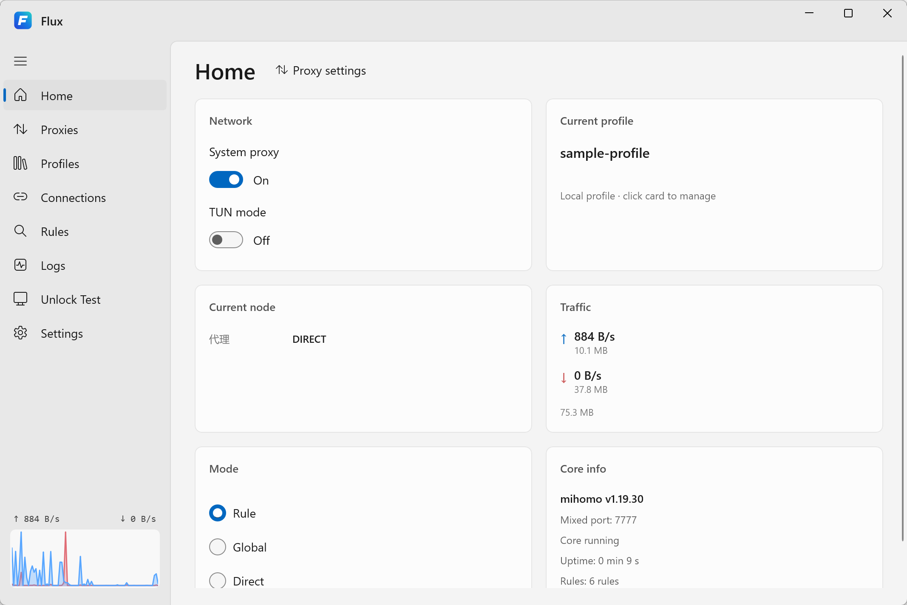
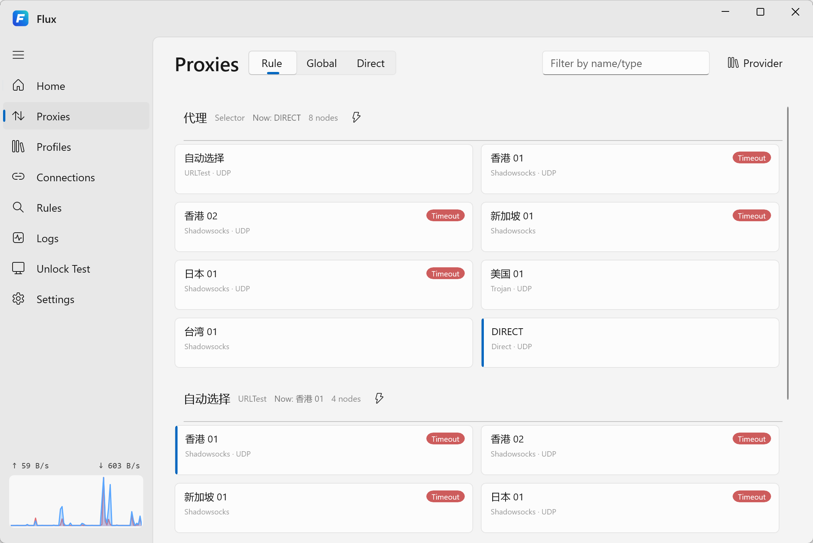

# Flux

[English](README.md) | [简体中文](README.zh-CN.md) | [繁體中文](README.zh-TW.md) | [日本語](README.ja.md) | 한국어 | [Deutsch](README.de.md) | [Español](README.es.md) | [Русский](README.ru.md) | [Türkçe](README.tr.md) | [Bahasa Indonesia](README.id.md) | [فارسی](README.fa.md) | [العربية](README.ar.md) | [Татарча](README.tt.md)

Flux는 [mihomo](https://github.com/MetaCubeX/mihomo) 코어를 사용하는 가벼운 Windows 프록시 클라이언트입니다. WinUI 3와 Fluent 디자인으로 제작되었습니다.

[다운로드](https://github.com/1595901624/flux/releases) · [문제 신고](https://github.com/1595901624/flux/issues) · [라이선스](LICENSE)

## 스크린샷

### 홈

시스템 프록시와 라우팅 모드를 관리하고, 활성 프로필, 현재 노드, 실시간 트래픽과 코어 상태를 확인합니다.



### 프록시 관리

그룹별 노드를 살펴보고 이름이나 유형으로 필터링하며, 노드를 전환하고 지연 시간을 테스트합니다.



스크린샷은 [`sample-profile.yaml`](sample-profile.yaml)의 데모 설정을 사용합니다. 서버 주소는 화면 표시용 예시이며 실제 프록시로 사용할 수 없습니다.

## 주요 기능

- **Windows 네이티브 UI**: WinUI 3, Mica 배경, Fluent 디자인과 다국어 인터페이스.
- **유연한 라우팅**: Rule, Global, Direct 모드와 시스템 프록시 및 TUN 제어.
- **프로필 관리**: Clash 호환 YAML 파일이나 구독 URL 가져오기, 프로필 전환과 구독 업데이트.
- **노드 관리**: 노드 선택, 이름·유형 필터, 프록시 제공자 조회와 지연 시간 테스트.
- **트래픽과 진단**: 실시간 업로드·다운로드 그래프, 활성 연결, 라우팅 규칙, 코어 로그와 서비스 차단 해제 테스트.
- **시스템 트레이**: 창을 닫으면 트레이로 숨겨지며, 트레이 메뉴에서 종료할 수 있습니다.
- **런타임 포함**: 배포 빌드에 mihomo, .NET과 Windows App SDK 구성 요소가 포함됩니다.

## 시작하기

**Windows 10 버전 2004(빌드 19041) 이상**의 x86, x64, ARM64를 지원합니다.

1. [릴리스 페이지](https://github.com/1595901624/flux/releases)에서 Windows 아키텍처에 맞는 패키지를 선택하고 해당 버전의 안내에 따라 설치합니다. 사이드로드 ZIP은 압축을 푼 뒤 포함된 `Install-FluxSideload.ps1`을 관리자 권한으로 실행합니다.
2. Flux를 실행하고 **Profiles**에서 구독 URL 또는 로컬 YAML 파일을 가져온 다음 프로필을 선택해 활성화합니다.
3. **Proxies**에서 노드나 그룹을 선택합니다. **Rule** 모드는 프로필의 규칙에 따라 트래픽을 분배합니다.
4. **Home**에서 **System proxy**를 켜면 Windows 프록시 설정을 따르는 앱이 Flux를 사용합니다.

TUN 모드에는 관리자 권한 또는 정상 작동하는 Flux 권한 서비스가 필요합니다. 창을 닫아도 트레이에서 계속 실행됩니다.

CI에서 생성한 서명되지 않은 MSIX는 개발 테스트용입니다. 포터블 ZIP이 제공되는 경우 압축을 풀고 `Flux.exe`를 실행하면 됩니다.

## 설정과 데이터

Flux는 `proxies`, `proxy-groups`, `rules`가 포함된 Clash 호환 YAML을 사용합니다. [`sample-profile.yaml`](sample-profile.yaml)을 참고하고 유효한 서버 정보나 구독 URL을 준비하세요. Flux 자체는 프록시 구독을 제공하지 않습니다.

설정, 프로필과 로그의 기본 저장 위치는 `%APPDATA%\flux`입니다. 쓰기 가능한 폴더의 포터블 버전에서는 실행 전에 `Flux.exe` 옆에 빈 `.config\PORTABLE` 파일을 만들면 데이터를 `.config\flux`에 저장합니다.

## 소스에서 빌드

Windows에 [.NET 10 SDK](https://dotnet.microsoft.com/download/dotnet/10.0)를 설치하세요. 프로젝트는 WinUI 3를 사용하고 Windows SDK `10.0.22621.0`을 대상으로 합니다. IDE는 .NET 10과 WinUI 3를 지원하는 Visual Studio 버전을 사용하세요.

```powershell
git clone https://github.com/1595901624/flux.git
cd flux
dotnet restore Flux.slnx
dotnet build Flux.csproj -c Release
dotnet run --project Flux.csproj -c Release --no-build
```

기본 대상은 `win-x64`입니다. 다른 아키텍처는 `-r win-x86` 또는 `-r win-arm64`를 지정하세요. 각 대상에 맞는 mihomo 코어가 저장소에 포함되어 있습니다.

테스트 실행:

```powershell
dotnet test tests/Flux.Tests/Flux.Tests.csproj -c Release
```

권한 서비스 구성 요소를 포함한 배포 패키징은 [빌드 워크플로](.github/workflows/build-msix.yml)를 참고하세요.

## 라이선스

Flux는 [GNU GPL v3.0](LICENSE)으로 배포됩니다. 포함된 mihomo의 버전, 체크섬, 해당 소스와 라이선스 정보는 [THIRD_PARTY_NOTICES.md](THIRD_PARTY_NOTICES.md)에 있습니다.
